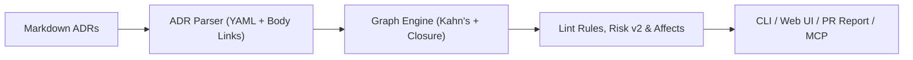

# NirnayDAG

Turns Markdown Architecture Decision Records (ADRs) into a dependency graph so you can detect cycles, compute blast radius, lint rules, map decisions to files, and expose architecture context over MCP.

[](https://www.npmjs.com/package/nirnay-dag)
[](https://github.com/Yash4305d-y/NirnayDAG/actions/workflows/ci.yml)
[](./LICENSE)


Try it now against your own ADR folder (or clone this repo to try the built-in `./docs/adr` and `./sample-adrs` examples, which are not bundled in the npm package):

```bash
# Against your own ADR directory:
npx nirnay-dag validate ./path/to/your-adrs

# Or clone this repository to run on the included ADRs:
git clone https://github.com/Yash4305d-y/NirnayDAG.git && cd NirnayDAG
npx nirnay-dag validate ./docs/adr
npx nirnay-dag blast ADR-0001 ./docs/adr
npx nirnay-dag serve ./docs/adr --open
```

## Why

Architecture Decision Records are usually plain Markdown documents, not queryable data. Because dependencies live in prose or unvalidated headers, teams cannot reliably ask "what breaks if we change this decision?" or "which decisions govern this file?" before editing code or reviewing a pull request. NirnayDAG parses Markdown ADRs into a Directed Acyclic Graph (DAG) so those checks run locally, in CI, and inside AI coding assistants.

## Features

> **Examples folder:** [./sample-adrs](./sample-adrs) contains 6 sample ADRs, including `0006-cycle-test-case.md` to demonstrate cycle detection (`ADR-0004 -> ADR-0006 -> ADR-0004`) and `0005-legacy-auth-system.md` as an orphan decision.

### `validate` — Check for cycles, missing dependencies, and duplicate IDs

```bash
npx nirnay-dag validate ./docs/adr
```

```text
✅ Architecture DAG validated successfully.
   - Total ADRs: 3
   - Root Decisions: 1
   - Zero Cycles: Verified
```

Pass `--strict-refs --strict` to fail on soft mutual references between body links.

### `blast` — Measure downstream impact and risk score

```bash
npx nirnay-dag blast ADR-0001 ./docs/adr
```

```text
ADR ID                    │ ADR-0001
Direct Dependents         │ 2
Also Referenced By (soft) │ 0
Cascade Count             │ 2
Max Depth                 │ 1
Affected Systems          │ untagged (2)
Risk Score                │ 66.5/100 (High)

Cascading Impacts:
 - ADR-0002
 - ADR-0003
```

Pass `--include-soft` to include body-link references in the traversal. The 0–100 risk score is a documented topological heuristic computed from hard edges only; see [docs/RISK_MODEL.md](docs/RISK_MODEL.md).

### `lint` — Enforce architecture lifecycle rules

```bash
npx nirnay-dag lint ./sample-adrs
```

```text
Severity │ Rule   │ Files                      │ Message
info     │ orphan │ 0005-legacy-auth-system.md │ Decision ADR-0005 has no incoming or outgoing edges (orphan).

Summary: 0 error(s), 0 warning(s), 1 info(s)
```

Built-in rules: `accepted-depends-on-deprecated`, `superseded-without-successor`, `broken-supersedes`, `orphan`, `affects-no-match`, and `deprecated-governs-code`.

### `why` — Map repo files to governing ADRs

```bash
npx nirnay-dag why src/core/dagEngine.ts ./docs/adr
```

```text
src/core/dagEngine.ts
  ADR-0001 — Choose Kahn's Topological Sort and Dagre for Graph Engine [accepted] (glob: src/core/dagEngine.ts)
```

### `serve` — Interactive web graph UI

```bash
npx nirnay-dag serve ./docs/adr --open
```

```text
🚀 NirnayDAG server running at http://127.0.0.1:5173
📁 Serving ADRs from: <repo>/docs/adr
```

Binds to `127.0.0.1` (loopback only) and serves a React Flow + Dagre graph canvas.

### `report` — Generate a PR Markdown summary

```bash
npx nirnay-dag report ./docs/adr
```

```text
Successfully wrote PR blast radius summary to <repo>/nirnay-pr-summary.md
```

Writes `nirnay-pr-summary.md` with DAG status, per-ADR risk table, downstream dependents, `affects` matches, and lint results.

### MCP server — Query architecture from AI assistants

Add to your Antigravity, Claude Desktop, or Cursor MCP configuration:

```json
{
  "mcpServers": {
    "nirnay-dag": {
      "command": "npx",
      "args": ["-y", "nirnay-dag", "mcp"],
      "env": {
        "ADR_DIR": "./docs/adr"
      }
    }
  }
}
```

Exposes 6 stdio tools: `list_adrs`, `get_adr_context`, `query_blast_radius`, `validate_architecture`, `lint_architecture`, and `get_adrs_for_files`. See [docs/ANTIGRAVITY_SETUP.md](docs/ANTIGRAVITY_SETUP.md) for workspace setup.

## Frontmatter Reference & Formats

NirnayDAG parses Markdown files (`*.md`, `*.mdx`) across MADR, Nygard, RFC, and KEP Markdown directory layouts (`README.md` / `index.md` derive fallback IDs from their parent directory).

```markdown
---
id: ADR-0002
title: Event-Driven Message Broker
status: accepted        # proposed | accepted | deprecated | superseded
depends_on:
  - ADR-0001
supersedes: []
tags:
  - messaging
affects:
  - "src/events/**"
---
```

**Honest limits:**
- Only Markdown files are parsed; KEP metadata stored in `kep.yaml` is not read directly.
- Hard dependencies require `depends_on` or `supersedes` in YAML frontmatter (or a `Supersedes ADR-XXXX` status line). Body Markdown links and `[ADR-XXXX]` tokens are tracked as **soft** references.
- `.nirnayrc.json` supports `rules` overrides (enable/disable and `error`/`warn`/`info` severity); directory `include`/`exclude` globs are not implemented.

## Tested on Real Repositories

Evaluated against 7 pinned open-source repositories (1,565 decision files total); exact figures from [results/corpus-results.json](results/corpus-results.json) and [docs/FINDINGS.md](docs/FINDINGS.md):

| Repository | Decision Files | Status Found % | Title Found % |
| :--- | :---: | :---: | :---: |
| `backstage/backstage` | 17 | 0% | 100% |
| `adr/madr` | 21 | 4.8% | 100% |
| `rust-lang/rfcs` | 654 | 0% | 7.5% |
| `kubernetes/enhancements` | 708 | 0% | 97.9% |
| `cosmos/cosmos-sdk` | 65 | 0% | 100% |
| `JabRef/jabref` | 88 | 9.1% | 100% |
| `alphagov/govuk-design-system-architecture` | 12 | 0% | 100% |

What the benchmark found:
- **Duplicate ID collisions:** 4 files collided before relative-path disambiguation (such as nested `README.md` files in `kubernetes/enhancements`).
- **Links that only look like dependencies:** Across 1,565 files, NirnayDAG found 456 resolved soft links, 176 non-decision links (e.g., images/docs), 16 outside-scope links, and 73 broken links.
- **Almost no machine-readable dependencies:** All 7 repositories had `0` hard edges (`depends_on` / `supersedes` frontmatter), leaving 1,188 of 1,565 nodes isolated.

## How It Works



Architecture decisions for NirnayDAG itself live in [docs/adr/](docs/adr/):
- [0001-dag-graph-engine.md](docs/adr/0001-dag-graph-engine.md)
- [0002-mcp-assistant-protocol.md](docs/adr/0002-mcp-assistant-protocol.md)
- [0003-hybrid-ingestion-strategy.md](docs/adr/0003-hybrid-ingestion-strategy.md)

## Development

```bash
git clone https://github.com/Yash4305d-y/NirnayDAG.git
cd NirnayDAG
npm ci
npm run check
```

`npm run check` runs TypeScript type-checking, Oxlint, Vite + tsup builds, and Vitest. See [CONTRIBUTING.md](CONTRIBUTING.md) and [SECURITY.md](SECURITY.md).

## License

MIT — see [LICENSE](LICENSE).
