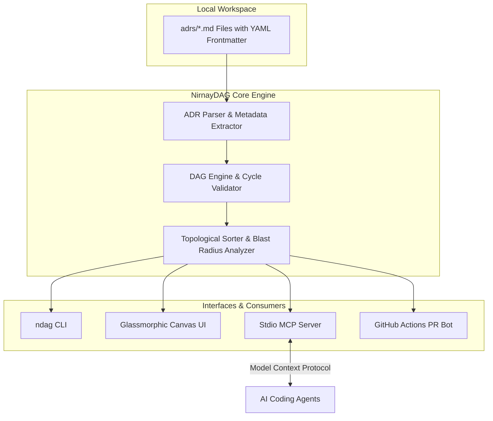

<div align="center">

# ☸️ NirnayDAG

### Directed Acyclic Graphs for Architectural Context & Decision Lineage

[](#)
[](#)
[](#)
[](#)

**NirnayDAG** (*Nirṇaya* / निर्णय — decisive resolution) transforms flat, disconnected Architecture Decision Records (ADRs) into an interactive, computational Directed Acyclic Graph. Map dependencies, run cycle-detection, simulate technical blast radiuses, and expose system context directly to AI coding agents via MCP.

</div>

---

## ⚡ Key Highlights

* 🕸️ **Deterministic Lineage:** Trace architectural choices from root infrastructure down to high-level application abstractions.
* 💥 **Blast Radius Engine:** Instantly compute which downstream systems, services, or decisions break when an upstream decision changes or is deprecated.
* 🛡️ **Zero-Cycle Validation:** Strict topological sorting using Kahn's algorithm catches circular dependencies and missing parent references at CI time.
* 🤖 **MCP-Native for AI Agents:** Built-in Model Context Protocol (MCP) server allows tools like Claude Desktop, Cursor, and Antigravity to query, navigate, and propose ADRs autonomously.
* ✨ **Mesmerizing Visualizer:** Dark-mode glassmorphic interface with real-time graph physics, bezier pulse-lines, and status glow shaders.

---

## 🏗️ System Architecture



---

## 🚀 Getting Started

### Installation
Clone the repository and install dependencies:
```bash
git clone https://github.com/your-org/NirnayDAG.git
cd NirnayDAG
npm install
```

### 1. Initialize a Workspace
To initialize NirnayDAG in any project, run:
```bash
npm run ndag -- init
```
This generates the `.nirnay/` config and an `adrs/` folder with a scaffolded initial decision.

### 2. Validate Graph Integrity
Ensure your architectural decisions form a valid DAG (no circular dependencies):
```bash
npm run ndag -- validate
```

### 3. Compute Blast Radius
Before making a change, see its downstream impact across all services and decisions:
```bash
npm run ndag -- blast ADR-002
```

### 4. Interactive Visualizer
Launch the interactive ReactFlow canvas to visually inspect your decisions:
```bash
npm run ndag -- serve
```

---

## 🤖 MCP Integration

NirnayDAG includes a fully compliant Stdio MCP server for integration with advanced AI agents like **Claude Desktop** and **Antigravity**.

Launch the server using:
```bash
npm run mcp
```

### Exposing Tools to AI:
Once connected via MCP, your AI agent can natively execute:
- `get_decision_graph()`
- `validate_architecture_dag()`
- `get_blast_radius({ adrId: 'ADR-100' })`
- `create_adr({ ... })`

---

## 📝 Creating ADRs
All ADRs are stored as standard Markdown files with YAML frontmatter.

**Example \`ADR-001.md\`**:
\`\`\`yaml
---
id: ADR-001
title: Adopt Event-Driven Architecture via Apache Kafka
category: Infrastructure
status: accepted
timestamp: 2026-01-15
dependencies: []
---

## Context
Synchronous REST microservices are leading to cascading timeouts...

## Decision
Implement an asynchronous event bus using Kafka...

## Consequences

### Positive
- Decoupled services
- High throughput

### Negative
- Eventual consistency complexity
\`\`\`

---

## 🤖 GitHub Actions CI/CD Integration

NirnayDAG comes with a built-in CI workflow that ensures your architecture stays clean and cycle-free. 

The included workflow (`.github/workflows/nirnay-ci.yml`) automatically:
1. Runs `ndag validate` on every Pull Request targeting the main branch.
2. Generates a **Blast Radius Impact Analysis** via a custom script (`scripts/pr-blast-radius.ts`).
3. Posts a rich markdown comment with a Mermaid graph directly to your PR, identifying which downstream services might break due to your changes.

To enable this, the workflow and scripts are automatically configured in the repository. No further setup is required beyond pushing to GitHub!

