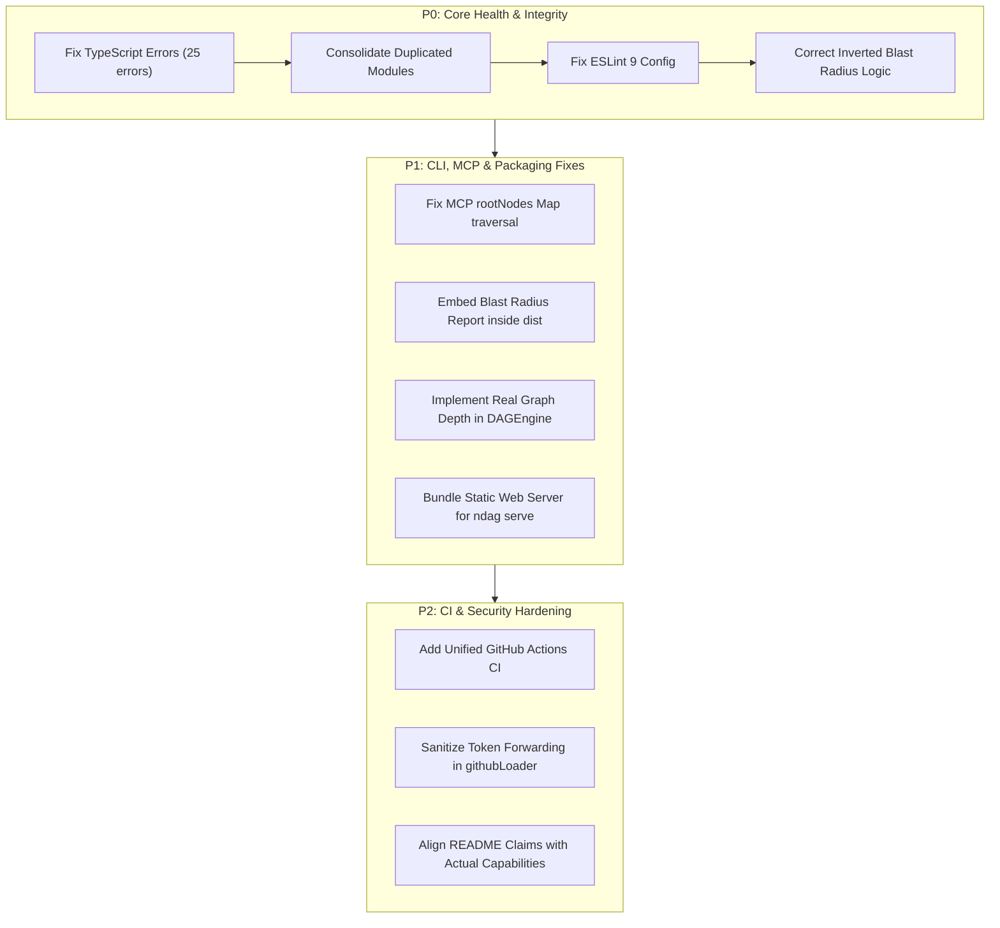

# NirnayDAG Phase 0 Audit Report

**Date:** 2026-11-24  
**Project:** NirnayDAG (`nirnay-dag@1.0.0`)  
**Scope:** Test Suite, Build System, README Claim Verification, CI/CD Workflows, Code Quality Risks, and Roadmap.

---

## 1. Test Suite & Build Verification

### 1.1 Test Suite (`npm test` / Vitest)
* **Command:** `npm test` (`vitest run`)
* **Status:** Passed
* **Exact Counts:**
  * **Test Files:** 5 passed (5 total)
    * `tests/dagEngine.test.ts` (8 passed)
    * `tests/adrParser.test.ts` (4 passed)
    * `src/__tests__/pipeline.test.ts` (1 passed)
    * `tests/mcpServer.test.ts` (5 passed)
    * `tests/cli/interactive.test.ts` (2 passed)
  * **Total Tests:** 20 passed, 0 failed (20 total)
  * **Duration:** 4.64s
* **Runtime Warnings:**
  * Node.js Deprecation Warning `DEP0190`: *"Passing args to a child process with shell option true can lead to security vulnerabilities, as the arguments are not escaped, only concatenated."* (triggered during subprocess execution in `tests/mcpServer.test.ts` and `interactive.test.ts`).

### 1.2 Build System (`npm run build`)
* **Commands:** `vite build && tsup`
* **Vite Web Build:** Passed (`dist/index.html`, `dist/assets/index-*.js`, `dist/assets/index-*.css`)
  * **Warning:** Output chunk `dist/assets/index-BgzUA2R5.js` is **682.77 kB** (> 500 kB threshold).
* **tsup Core/CLI/MCP Build:** Passed
  * **Warning:** `import.meta` is not available with the `cjs` output format and will be empty in `src/cli/index.ts:14:33`.
  * Outputs generated: `dist/cli.js`, `dist/cli.cjs`, `dist/index.js`, `dist/index.cjs`, `dist/mcp.js`, `dist/mcp.cjs` + `.d.ts` declaration files.

### 1.3 TypeScript Compilation (`npx tsc --noEmit`)
* **Command:** `npx tsc --noEmit`
* **Status:** **FAILED (Exit Code 1)**
* **Total Errors:** **25 TypeScript errors** across CLI, UI, parser, and utility modules:
  * `src/cli/commands/validate.ts`: TS2339 (`Property 'errors' does not exist on type 'DAGValidationResult'`).
  * `src/cli/interactive.tsx`: TS2322 (`marginTop` does not exist on Ink `Text` props), TS2345 (`useEffect` returns `() => Promise<void>` instead of `void | Destructor`).
  * `src/mocks/sampleAdrs.ts`: TS2339 (`Property 'glob' does not exist on type 'ImportMeta'`).
  * `src/ui/components/NirnayCanvas.tsx`: TS2345 (Type mismatch between `Record<string, string[]>` and `BlastRadiusMap`), TS2882 (Cannot find style module `@xyflow/react/dist/style.css`).
  * `src/ui/components/DecisionNode.tsx` & `StitchNodeCard.tsx`: TS7053 (Element implicitly has `any` type indexing `Record<DecisionStatus, ...>`).
  * `src/utils/localFolderLoader.ts`: TS18046 (`window.showDirectoryPicker` is of type `unknown`).
  * Multiple TS6133 unused variable/import errors across UI and CLI files.

### 1.4 Linter Status (`npm run lint` & `oxlint`)
* **`npm run lint` (`eslint .`):** **FAILED (Exit Code 1)**
  * ESLint v9 is installed, but no flat config file (`eslint.config.js`) exists in the repository.
* **`npx oxlint`:** 30 warnings, 0 errors across 55 files (unused variables, empty catch blocks, unnecessary regex escapes, Fast Refresh hook violations in `interactive.tsx`).

---

## 2. README.md Claim Verification vs. Reality

| Claim in README | Reality in Codebase | Verdict | Details |
| :--- | :--- | :---: | :--- |
| **Cycle Detection (Kahn's Algorithm)** | Implemented in `src/core/dagEngine.ts`, tested in `tests/dagEngine.test.ts`. | **VERIFIED** | Correctly detects circular dependencies and extracts cycle path via DFS. |
| **Blast Radius: Direct Dependents** | Buggy calculation in CLI, MCP, and scripts. Mislabels upstream dependencies as downstream dependents. | **PARTIAL / BUGGY** | Code uses `adr.dependencies` (what the ADR depends on) as `directDependents` instead of querying the adjacency list for nodes that depend *on* the ADR. |
| **Blast Radius: Transitive Dependencies** | Implemented via BFS queue traversal in `dagEngine.getBlastRadius`. | **VERIFIED** | Correctly collects all reachable downstream impacted nodes. |
| **Blast Radius: Hierarchy Depth** | Completely fabricated mock calculation in MCP and CLI reports. | **FAKE / UNTESTED** | `src/core/dagEngine.ts` does NOT compute depth. `scripts/pr-blast-radius.ts` and `src/mcp/server.ts` use: `Math.ceil(downstreamIds.length / 2)`. |
| **Blast Radius: Affected Systems** | Not implemented. | **MISSING** | No tags or system grouping logic exists in `dagEngine.ts` or `getBlastRadius()`. |
| **Risk Score (0–100)** | Inconsistent, uncalibrated heuristics. | **PARTIAL** | CLI/MCP uses `score = Math.min(100, downstream.length * 10 + direct.length * 5)` (with buggy `direct`), while `SimulationEngine` uses an incompatible category weight calculation. |
| **Zero-Install Web Canvas (`ndag serve`)** | Broken for external projects; does not load target directory ADRs into UI. | **BROKEN** | 1. `ndag serve` invokes `npm run dev` in the current working directory.<br>2. The browser canvas loads with empty state; no backend endpoint serves the CLI directory to the UI. |
| **Stdio MCP Server (`ndag mcp`)** | Implemented but has a silent critical bug in `validate_architecture`. | **PARTIAL / BUGGY** | In `src/mcp/server.ts`, `rootNodes` evaluates `Object.keys(engine['adjacencyList'])`. Since `adjacencyList` is a private `Map`, `Object.keys()` returns `[]` on every call. |
| **CI/CD PR Gating & Markdown Reports** | Fails in npm installations; broken GitHub workflow configs. | **BROKEN** | 1. `ndag report` executes `scripts/pr-blast-radius.ts`, which is omitted from npm release `files` in `package.json`.<br>2. Workflows call non-existent npm scripts (`lint:adrs`, `npm run ndag`). |
| **Universal Format Support (MADR, RFC, KEP)** | Generic regex heuristic only. No format-specific parsers. | **PARTIAL / UNTESTED** | No KEP parser (`kep-number`, `owning-sig`) or RFC parser exists. MADR list-based metadata without YAML frontmatter is lost. |
| **Interactive TUI Mode (`ndag interactive`)** | Ink TUI implemented, but only `--json` fallback is automated in test suite. | **UNTESTED TUI** | Automated tests only cover non-interactive fallback. Command palette (`:`) only recognizes `q` and `v`, silently ignoring everything else. |

---

## 3. CI/CD Analysis & Proposed Workflow

### 3.1 Existing Workflows Status
The repository contains three files in `.github/workflows/`, all of which are dysfunctional:
1. **`.github/workflows/adr-lint.yml`:**
   * Step `Run ADR Linter` executes `npm run lint:adrs`.
   * **Failure:** `lint:adrs` does not exist in `package.json`.
2. **`.github/workflows/nirnay-ci.yml`:**
   * Step `Run NirnayDAG Validation` executes `npm run ndag -- validate`.
   * **Failure:** `ndag` does not exist in `package.json` scripts.
   * Does not build or test the NirnayDAG codebase itself.
3. **`.github/workflows/publish-npm.yml`:**
   * Only triggers on release publication. Runs `npm test` and `npm run build`, but does not run on PRs.

### 3.2 Proposed Minimal CI Workflow (`.github/workflows/ci.yml`)
*(Note: Per Phase 0 guidelines, this workflow is proposed here and NOT yet created in the filesystem.)*

```yaml
name: CI

on:
  push:
    branches: [main]
  pull_request:
    branches: [main]

jobs:
  validate-and-test:
    name: Build, Lint & Test (Node ${{ matrix.node-version }})
    runs-on: ubuntu-latest
    strategy:
      matrix:
        node-version: [18.x, 20.x, 22.x]

    steps:
      - name: Checkout Code
        uses: actions/checkout@v4

      - name: Setup Node.js ${{ matrix.node-version }}
        uses: actions/setup-node@v4
        with:
          node-version: ${{ matrix.node-version }}
          cache: 'npm'

      - name: Install Dependencies
        run: npm ci

      - name: Type Check (TypeScript)
        run: npx tsc --noEmit

      - name: Lint (Oxlint / ESLint)
        run: npx oxlint

      - name: Run Test Suite
        run: npm test

      - name: Build Packages (CLI, MCP, Web)
        run: npm run build
```

---

## 4. Top 10 Risks to Code Quality

### Risk 1: Unchecked TypeScript Compilation Failure (25 Errors)
* **Location:** Whole project (`npx tsc --noEmit`)
* **Impact:** `npm run build` succeeds only because `vite build` and `tsup` bypass strict type checking. Types in UI, CLI, and loaders are broken, causing runtime crashes if unvetted code paths execute.

### Risk 2: Broken ESLint 9 Setup (`npm run lint` Crash)
* **Location:** `package.json`, root directory
* **Impact:** ESLint v9 fails immediately because of missing `eslint.config.js`. Developers and CI cannot run linting without encountering build errors.

### Risk 3: Inverted Dependency Semantics in Blast Radius & Risk Score
* **Location:** `src/cli/index.ts:103`, `src/mcp/server.ts:146`, `scripts/pr-blast-radius.ts:93`, `src/cli/interactive.tsx:132`
* **Impact:** The code assigns `direct = adr.dependencies` (what the ADR depends on) as `directDependents`. For root ADRs with many dependents but 0 upstream dependencies, the score ignores direct dependents; conversely, a leaf node with 5 dependencies receives inflated risk.

### Risk 4: Fabricated Metrics (Mock Depth Calculation)
* **Location:** `src/mcp/server.ts:153`, `scripts/pr-blast-radius.ts:94`
* **Impact:** Hierarchy depth is fabricated using `Math.ceil(downstreamIds.length / 2)`. Users and AI assistants relying on MCP receive fictitious structural depth metrics.

### Risk 5: Broken MCP Tool Logic (`rootNodes` Empty Array)
* **Location:** `src/mcp/server.ts:162-165`
* **Impact:** MCP `validate_architecture` runs `Object.keys(engine['adjacencyList'])`. In TypeScript/ESM, `adjacencyList` is a `Map`, so `Object.keys()` always returns `[]`. Root decisions are never returned.

### Risk 6: Broken CLI External Ingestion & Local Server Architecture
* **Location:** `src/cli/index.ts:136`, `src/cli/commands/serve.ts:18`
* **Impact:** `ndag serve` invokes `npm run dev` or `npx vite` in the user's host repo. If installed via npx or global npm, this crashes or launches the user's dev server instead of serving NirnayDAG. Additionally, the web app lacks any local API to read ADRs from disk.

### Risk 7: Extreme Test Coverage Deficit (~90% Untested Modules)
* **Location:** UI components, `layoutEngine.ts`, `simulationEngine.ts`, `exportEngine.ts`, `githubLoader.ts`, `localFolderLoader.ts`, `interactive.tsx`
* **Impact:** 36 out of 40 source modules have 0 unit or integration tests. Regressions in graph rendering, export to PNG/SVG, or interactive TUI will go completely undetected.

### Risk 8: Security, Rate Limiting & Cross-Origin Token Leakage in `githubLoader.ts`
* **Location:** `src/utils/githubLoader.ts:18-20, 66`
* **Impact:** 
  1. The user's GitHub Personal Access Token is attached as `Authorization: Bearer` to `item.download_url`, which resolves to `raw.githubusercontent.com`.
  2. No rate-limit reset handling or pagination support for directories with >1000 files.

### Risk 9: Dead Code, Abandoned Modules & Directory Duplication
* **Location:** `src/cli/commands/*`, `src/parser/adrParser.ts`, `src/types/adr.ts`, `src/utils/exportGraph.ts`, `src/cli/lint.ts`, `src/cli/utils.ts`
* **Impact:** The codebase has two parallel parser modules, two conflicting `DAGValidationResult` interfaces, two export engines, and an abandoned `src/cli/commands` directory that causes TypeScript compiler errors.

### Risk 10: Broken Packaging for CI Scripts in npm Distribution
* **Location:** `package.json:15-19`, `src/cli/index.ts:164`
* **Impact:** `package.json` specifies `"files": ["dist", "bin", "README.md"]`. The command `ndag report` spawns `scripts/pr-blast-radius.ts`, which will NOT be present in published npm packages, causing `npx nirnay-dag report` to fail in user CI pipelines.

---

## 5. Prioritized Fix Roadmap (Phase 1+)



### Priority 0: Immediate Stability & Build Integrity (Must Fix First)
1. **Resolve 25 TypeScript Errors:**
   * Fix `src/ui/components/NirnayCanvas.tsx` `BlastRadiusMap` typing.
   * Fix `window.showDirectoryPicker` type definition or cast in `localFolderLoader.ts`.
   * Fix `interactive.tsx` Ink component props and `useEffect` return signature.
   * Delete or archive dead files in `src/cli/commands/` and unused duplicate files.
2. **Consolidate Duplicate Code:**
   * Unify `src/types/adr.ts` and `src/core/types.ts`.
   * Unify `src/parser/adrParser.ts` into `src/core/adrParser.ts`.
   * Unify `src/utils/exportGraph.ts` into `src/utils/exportEngine.ts`.
3. **Fix ESLint / Lint Script:**
   * Add a valid `eslint.config.js` or configure `npm run lint` to run `oxlint`.
4. **Fix Inverted Blast Radius Semantics:**
   * In `DAGEngine`, expose `getDirectDependents(id)` using `adjacencyList.get(id)`.
   * Update CLI, MCP, and `pr-blast-radius.ts` to compute risk based on actual dependents.

### Priority 1: Functional Corrections & Packaging
5. **Fix MCP Server `rootNodes` Resolution:**
   * Iterate over `adjacencyList.keys()` using `Map` iterator, not `Object.keys()`.
6. **Package `pr-blast-radius` in compiled build:**
   * Move report logic from `scripts/` into compiled library code (`src/core/report.ts` or `src/cli/commands/report.ts`).
7. **Implement Accurate Depth Calculation:**
   * Add genuine longest-path or BFS level computation in `DAGEngine` instead of `Math.ceil(n/2)`.
8. **Fix `ndag serve` Standalone Web Architecture:**
   * Serve the compiled `dist` directory via lightweight static HTTP server (e.g. Express or `serve-handler`) and inject local ADR files via an API endpoint.

### Priority 2: CI, Security & Documentation Alignment
9. **Deploy Unified GitHub Actions CI:**
   * Create `.github/workflows/ci.yml` running on Node 18, 20, 22 with lint, typecheck, test, and build.
   * Fix or deprecate existing `adr-lint.yml` and `nirnay-ci.yml`.
10. **Harden `githubLoader.ts`:**
    * Strip `Authorization` header when fetching `raw.githubusercontent.com` download URLs.
    * Add rate limit detection and user-friendly error messages.
11. **Update `README.md`:**
    * Clarify format support (generic Markdown + frontmatter), document accurate risk scoring, and update CLI instructions.
